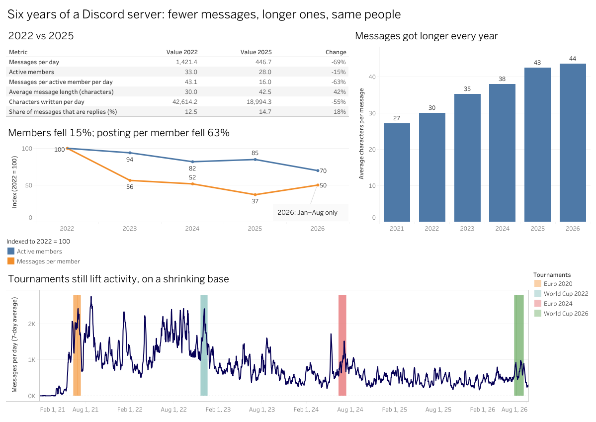
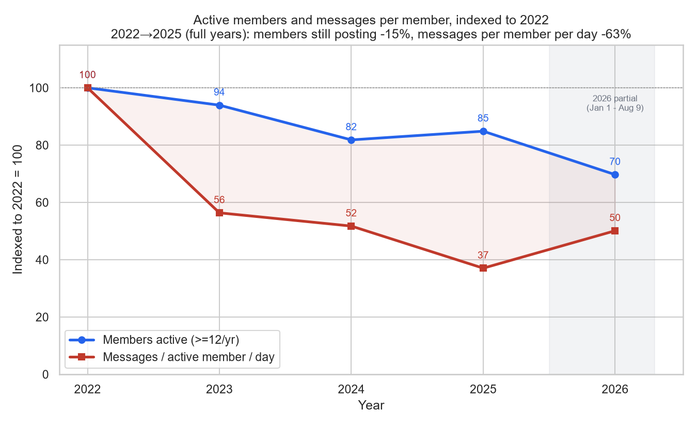
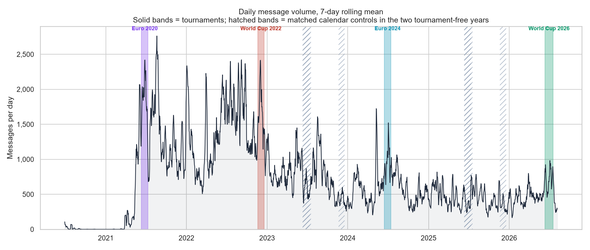
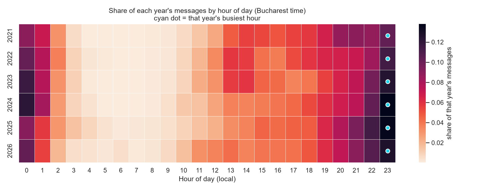
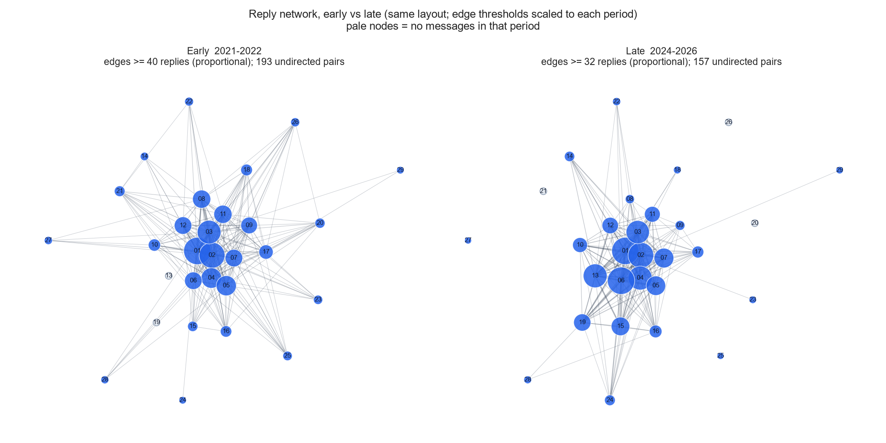
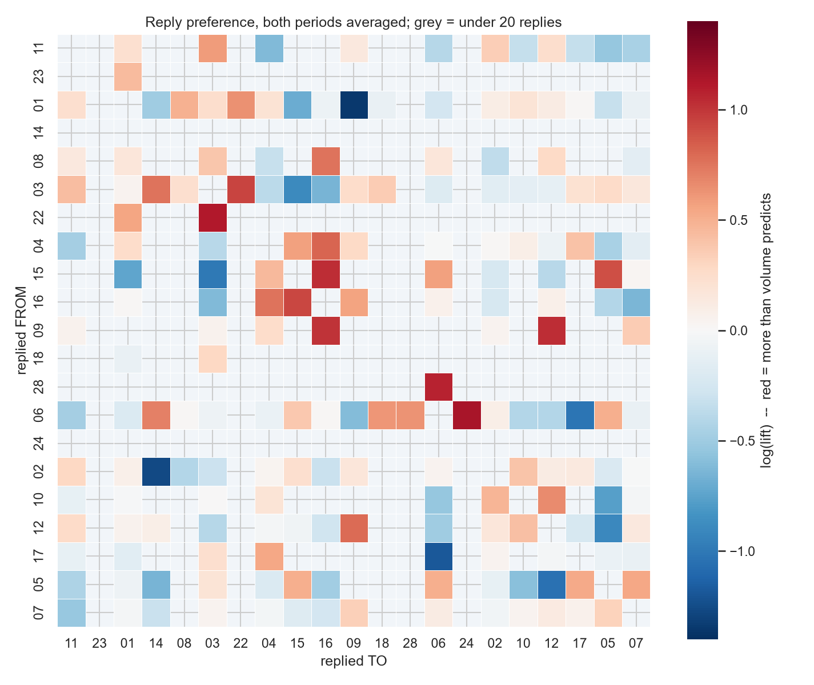
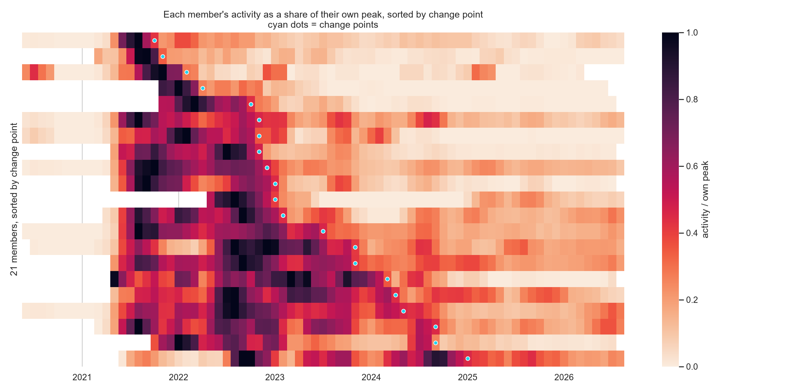

# Six years of a Discord server, 1.6 million messages

**A closed friend group's message volume fell by more than two thirds between 2022 and 2025, and
the amount it actually wrote by just over half, because its messages got longer. This is an
analysis of what changed and what didn't.**

**The question:** the server got much quieter after 2022. Did people leave, or post less? And did
anything else about how the group talks change?

**What I did:** exported the server's message history (a server I have been a member of since
2021), loaded it into PostgreSQL, pseudonymised every member, and answered the question in five
steps with SQL and Python. The results are summarised in three Tableau dashboards.

**Tools:** PostgreSQL · Python (pandas, NumPy, SciPy, networkx) · seaborn / matplotlib · Jupyter ·
Tableau

**Contents:** [In short](#in-short) · [Dashboards](#interactive-dashboard) ·
[Findings](#findings) · [What I got wrong](#what-i-got-wrong) · [Data and
method](#data-and-method) · [Caveats](#caveats) · [Repository](#repository)

## In short

- **People mostly posted less; they didn't mostly leave.** From 2022 to 2025, messages per day fell
  69%. Active members fell 15%; messages per member fell 63%.
- **Messages got longer.** The average message went from 30 to 43 characters, so the amount of
  text fell 55%, not 69%. Short messages disappeared the most.
- **Daily habits stayed the same.** The busiest hour is 23:00 in every year, and counted in messages,
  replies come as promptly as they did in 2022. More messages are now sent as explicit replies.
- **The core stayed connected.** The 15 core members all still reply to one another, and who
  prefers whom is largely the same as years ago.
- **People went quiet at different times.** Each member's lasting drop below half their own peak
  falls somewhere across 39 months: a staircase, not a cliff. Three members never dropped below
  half for good.

> **On privacy.** This is a private group's conversation. Every member is pseudonymised
> (`user_01`…`user_50`), and no message text, usernames or Discord IDs appear in this repository.
> The name mapping stays on my machine, excluded by `.gitignore`, and `scripts/leak_check.py`
> checks the files for real names and IDs before anything is published. Someone who was in the
> server could probably still recognise members from their activity patterns, so the most
> detailed data (each member's messages by date and hour) is kept private.

## Interactive dashboard

**[Explore the dashboards on Tableau Public →](https://public.tableau.com/app/profile/raul.c.4596/viz/DiscordAnalysis/Thedecline)**

- **The decline:** the 2022 vs 2025 headline numbers, members vs posting per member, messages
  getting longer, and daily volume with the four tournaments.
- **Who went quiet:** every analysed member's activity against their own peak, month by month.
  Click a square to see one member's decline.
- **Who talks to whom:** the busiest reply pairs next to lift (replies relative to what each
  pair's activity predicts), for 2021–22 and 2024–26.



The dashboards read only tables built from the notebook outputs. The workbook, its data and the
other two screenshots are in [`dashboard/`](dashboard/).

---

## Findings

### 1. The decline is intensity, not population

Comparing 2022 (the peak) to 2025 (the last complete year), the drop decomposes exactly:

| | 2022 | 2025 | |
|---|---|---|---|
| Messages per day | 1,421.4 | 446.7 | ×0.314 (**−69%**) |
| Members posting ≥12 that year | 33 | 28 | ×0.848 (−15%) |
| Messages per active member per day | 43.1 | 16.0 | ×0.370 (**−63%**) |

`0.848 × 0.370 = 0.314`. Lower posting per member accounts for most of the drop, and fewer
active members for a smaller part.



**Counted in text rather than messages, the decline is smaller.** Messages got longer every year,
from a mean of 30 characters in 2022 to 43 in 2025, so the amount written fell **55%**, not 69%.
It is still mostly people posting less, and the lengthening is mostly the same people writing
longer messages. What disappeared was mostly short messages: those of 1–5 characters fell 82%,
against 11% for messages over 200 characters.

The 2022 World Cup isn't behind the decline: it added 16,418 messages, and removing them moves the
headline from −68.6% to about −67.5% ([notebook 02](notebooks/02_tournaments.ipynb)). The checks on
how people split their messages and on media are in [notebook 01](notebooks/01_decomposition.ipynb).

### 2. The community still responds to events, in proportion

Four tournaments, each compared with the 28 days before it:

| | Baseline/day | During/day | Multiplier | Absolute lift |
|---|---|---|---|---|
| Euro 2020 (played 2021) | 1,256.8 | 1,876.3 | **1.49×** | +620/day |
| World Cup 2022 | 1,224.5 | 1,790.7 | **1.46×** | +566/day |
| Euro 2024 | 610.8 | 991.5 | **1.62×** | +381/day |
| World Cup 2026 | 476.0 | 745.7 | **1.57×** | +270/day |
| *matched controls: each tournament's own dates in 2023 & 2025* | | | *0.54–1.13×* | |



The multiplier stays at 1.46–1.62× while the absolute lift falls 56%: a similar proportional
response each time, on a smaller base. Tournaments mostly make the same people post more: volume
goes ×1.5, the number of people posting each day only ×1.03–1.08. Euro 2020's 1.49× is unreliable, because the server was still growing
fast then. Details in [notebook 02](notebooks/02_tournaments.ipynb).

### 3. The room's rhythm did not change

My original plan expected the decline to come from members moving from study into work. Four
measures should have moved if that were true. None supported it:

| | Prediction | Result |
|---|---|---|
| Posting hour | drifts **earlier** | **Peak is 23:00 in all six years.** A minority drifts ~1h *later* |
| Weekend share | **rises** | No effect detectable at quarterly resolution |
| Seasonality | academic troughs fade | Partial, and inseparable from the football calendar |
| Reply latency | **rises** | Raw ×3.1, but unchanged when counted in messages |



The median reply time tripled, from 42s to 131s, but a quieter room produces slower replies on its
own. Counted as **how many messages went past before the reply**, the number is 3 in every year
from 2022 on. What this can't say is why replies got slower in seconds: fewer messages arriving
and slower individual replies both stretch the time in the same way.

Two things changed: the share of messages sent as explicit replies rose from 12.5% to 16.0%
(2022→2026), and messages got longer. Both are mostly the same people changing how they write, not
a change in who is left. Why they changed is not identified here. Details in
[notebook 03](notebooks/03_corroborating.ipynb).

### 4. The core network stayed fully connected



Among the **15 members who both carry the server and use the reply feature, all 210 directed pairs
exchanged replies in both periods** (2021–22 and 2024–26). Density appears to fall 27%, but among
members with at least 500 messages in each period it falls 1%. Most of the apparent fall comes
from members who stopped posting.

Not every pair talks equally, though. Comparing each pair's replies with what their two volumes
alone predict (`lift = observed / expected`):



- Lift varies far more than chance would produce, and the preferences lasted: across the 191
  one-way links with at least 20 replies in both periods, log-lift correlates **+0.73** (Pearson)
  between the early and late periods.
- Raw counts show volume, not preference. Averaging both directions and both periods, the busiest
  pair, `user_01` & `user_02`, has a lift of only about 1.1×; the strongest preferences are
  elsewhere, such as `user_03` & `user_22` at 2.8× (2.0× early, 3.7× late).
- There are faint but real groups, and members mostly stay in the same one across periods.
- Shared schedules explain part of it. Matching on who was posting in the same date and hour
  removes about 30% of the spread in lift, and the correlation stays at 0.72. This doesn't cleanly
  separate preference from schedules: posting only approximates being online, and friends who
  like talking also turn up together, so the adjustment can remove real preference too.

The null models, group detection and schedule checks are in
[notebook 04](notebooks/04_network.ipynb).

### 5. They went quiet at different times



Each member's change point is the first month their trailing 3-month activity falls below half
their own peak and never recovers. **21 of 24 have one, spread across 39 months** (2021-10 →
2025-01). This isn't just people peaking at different times: personal peaks span 19 months.

**The dates don't say why.** A change point marks a member's *final* drop, and 11 of the 21
dropped below half, recovered, and only later dropped for good. So a shared cause could still
produce spread-out dates. The data shows a staggered decline, not whether its causes were personal
or shared.

Three members have no change point, including the **only two whose volume grew** from 2022 to
2025. Between them, the three went from 3.0% of server volume in 2021 to
18.2% in 2026.

These figures are for message counts; counted in characters, the staggered pattern holds but the
exact numbers change. Sensitivity checks are in [notebook 05](notebooks/05_changepoints.ipynb).

---

## What I got wrong

**Two predictions were written down in advance and turned out false:** that posting hours would
drift earlier (they drifted later, for a minority), and that members would fade together (they
spread across 39 months). The second was written into `sql/05_changepoints.sql` before the
analysis ran.

**Eleven claims were withdrawn after checking.** Three examples:

| Claim | Why it failed |
|---|---|
| "Network density fell 27%" | Members who stopped posting have no replies afterwards. Among members with at least 500 messages in each period, it fell 1% |
| "There are no communities in this network" | Not tested against chance. Tested, the groups are faint but real |
| "Almost nothing changed except the amount" (the original headline) | Measured in messages only. Messages got 42% longer, so the text written fell 55%, not 69% |

## Data and method

| | |
|---|---|
| Source | DiscordChatExporter JSON, single channel, loaded into PostgreSQL |
| Span | 2020-06-26 → 2026-08-09 |
| Messages | 1,629,566 total → **1,613,543 conversational** (bots and system events removed) |
| Accounts | 50 human accounts; **46 ever posted**; **29** clear the 1,000-message floor used for member-level analysis |

When the database is available, each notebook runs its SQL queries and saves the results to
`outputs/tables/`. The analysis and charts read only those saved tables, so the notebooks also run
without the database. Recurring controls: comparing like with like across periods (per-message
rates, equal sample sizes, matched calendar dates), and hour-of-day averages on a clock starting
at 07:00, so that posts after midnight count as late.

Discord records when someone joins but not when they leave, so leaving and going silent look the
same in the data. Departures are known for only a few members, from my own knowledge.

## Caveats

- **2026 is partial** (to 9 August), so the headline comparison is 2022 → 2025. **2020 is
  pre-community** and excluded from every trend.
- **Single channel.** Anything said elsewhere in the server, in voice or in DMs is invisible.
- **Volume measures discussion, not attention.** The Euro 2020 final was one of the quietest days
  of its own tournament: people watching together register as silence.
- **The reply graph only sees the Reply button,** not conversation in general.
- **One reference timezone** (`Europe/Bucharest`) for members across Europe and the Americas. Safe
  for measuring change over time; absolute hours are that timezone's clock.
- **Characters are a proxy too.** Nothing here measures what was actually said.
- **The change-point rule is one defensible choice;** sensitivity checks are in notebook 05.
- **Life stage is inferred, never observed.** Nothing in the data records age, work or
  circumstances.

## Repository

```
sql/          00 setup, 01-05 one file per step
notebooks/    01-05, each executed end to end
scripts/      notebook builders, pseudonymisation, database setup,
              leak check, dashboard data
outputs/      tables/ (42 CSVs) and charts/ (22 PNGs)
dashboard/    Tableau workbook, its data and screenshots
data/         synthetic 20-row sample showing the schema shape
```

Rebuild everything (needs my private database):

```bash
python scripts/build_pseudonyms.py
python scripts/setup_db.py
python scripts/run_notebook.py 01 02 03 04 05
python scripts/build_dashboard_data.py
```

Without the database, `python scripts/run_notebook.py 01 02 03 04 05` still runs every notebook
from the saved tables; only one schedule check in Step 4 is skipped, because it needs the private
hourly tables. Python packages are in `requirements.txt`.

## A note on tooling

Built with Claude Code as a pair programmer. I chose the questions, made the methodological
decisions, and reviewed every output, including the eleven claims that did not survive that
review. The SQL, the notebooks and the charts were written with AI assistance.
